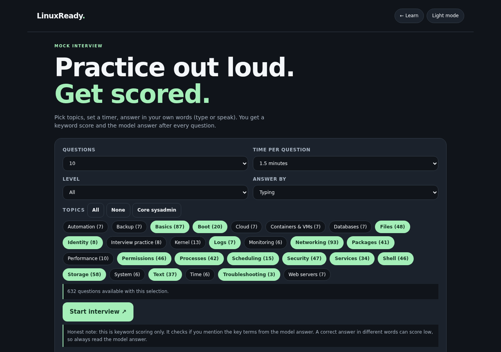
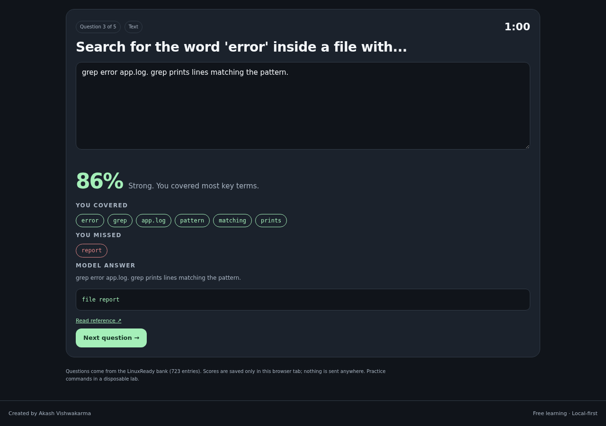
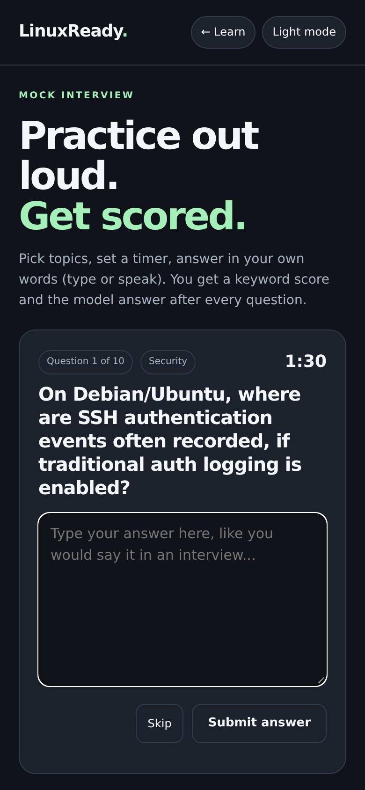

# LinuxReady

391 Q&A/coaching/scenarios and 332 explained quiz questions (723 items).

Major-topic map on the site, source links per card, dark/light, search, filters, local bookmarks. English technical answers plus optional Hinglish guidance. No accounts, telemetry, command execution or external runtime scripts.

## Interview Simulator

`interview-sim.html` is a mock interview using the same question bank: choose topics, level, count and a per-question timer, answer by typing or by speaking (browser speech input where available), then get a keyword score, the key terms you covered or missed, the model answer and the source link. Weak topics can be retried. It is keyword scoring only, so a correct answer in different words can score low. Nothing is sent anywhere.

## Coverage limits

Broad admin/interview coverage, not every Linux concept. Kernel/modules, cgroups/namespaces, networking, permissions, processes, packages, storage, RAID/LUKS/XFS, services/boot/systemd, shell, logs, security, backup, time, identity, performance and troubleshooting are included. Ansible, Docker/KVM, databases, web servers and cloud are introductory adjacent admin skills. Deeper gaps remain: eBPF/kernel development, Btrfs/ZFS, HA/clustering, advanced routing/VPN, mail/DNS servers, Kubernetes and database replication/recovery.

## Maintenance and safety

GitHub Pages serves main/root. New coverage is loaded by 1-interview-coverage.js before 4-data.js and 3-app.js. Source ledger is 6-SOURCES.md; verification notes 7-TESTS.md. Numeric prefixes are upload names, not missing dependencies. Reference-checked new examples are not claimed run on real servers. Inspect installed manuals and use disposable labs. No private biography or credentials in learning cards.
